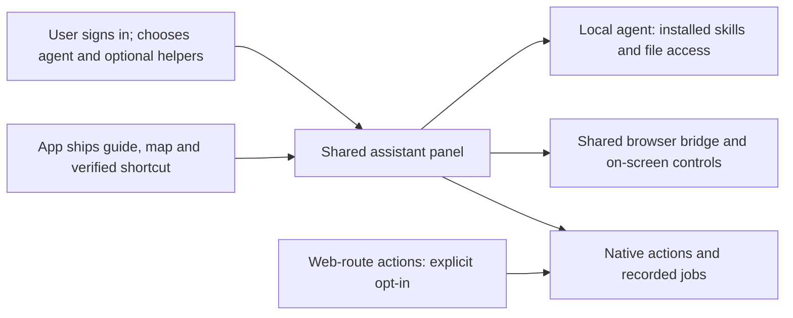

# PyFLASH

[](https://doi.org/10.5281/zenodo.21933060)

[](https://pyflash.readthedocs.io/en/latest/)
[](https://pypi.org/project/PyFLASH-analysis/)

A Python package for processing and analyzing immunofluorescence (IF) confocal microscopy data exported from the FLASH ImageJ Plugin.

Try the supplied simulated subject table from the repository root:

```python
import pandas as pd
from PyFLASH import from_dataframe
from PyFLASH.stats import runITTest
table = pd.read_csv("demo/data/summary.csv")
experiment = from_dataframe(table, group_col="Condition", subject_col="AnimalName")
groups = [experiment.summary.loc[experiment.summary.Condition == g, "Signal_MeanIntensity"] for g in ("A", "B")]
result = runITTest(*groups, {}, equal_var=False)
print(result[2])  # Welch t statistic and two-sided p-value; simulated data
```

**[Documentation](https://pyflash.readthedocs.io/)**

## What it does

Developer architecture and regression checks: [project contracts](docs/project-contracts.md).

Takes CSV exports from ImageJ's 3D Object Counter and other plugins, processes them into structured experiment/batch objects, performs statistical analysis, generates publication-quality plots, and exports formatted Excel summaries.

## Installation

```bash
pip install PyFLASH-analysis
```

### Typical installation time

On a normal desktop or laptop (at least 4 CPU cores, 8 GB RAM, an SSD, and a
stable broadband connection), allow approximately **2-5 minutes** to install
PyFLASH and its required dependencies into a fresh Python environment.
Python must already be installed. This is a planning estimate; download speed,
existing packages and availability of prebuilt dependencies affect the time.
Installing Python itself or optional extras takes additional time.

For reference, an uncached installation of PyFLASH-analysis 0.2.0 from PyPI
into a fresh environment took **4 minutes 4 seconds** on 30 September 2026
(Windows 11, Python 3.12.10, AMD Ryzen 7 7730U, 32 GB RAM, SSD). This includes
required dependency downloads and installation; it excludes installing Python
and creating the environment. See [`demo/verification.json`](demo/verification.json).

## License

PyFLASH is distributed under the BSD 3-Clause License. See `LICENSE`.

**Requires:** Python ≥ 3.10

**Required dependencies (minimum versions):** reprofig 0.5.1, pandas 1.5,
numpy 1.23, matplotlib 3.6, seaborn 0.12, scipy 1.11, statsmodels 0.14,
scikit-posthocs 0.9, scikit-learn 1.2, openpyxl 3.0, read-roi 1.6, and Pillow 9.0.
`pip` installs these automatically; the authoritative requirements are in
[`pyproject.toml`](pyproject.toml).

**Hardware and operating systems:** no GPU or other non-standard hardware is
required for the demo. The package uses cross-platform Python dependencies.
The demo was verified on Windows 11 with Python 3.12.10 and PyFLASH-analysis
0.2.0; macOS and Linux were not tested in this verification run.

The PyPI distribution is `PyFLASH-analysis`; the Python import package is `PyFLASH`.
For local development, install from the repository with `pip install -e .`.
For local notebook testing, start Jupyter from this repository and run `pip install -e .`; the editable `PyFLASH-analysis` install points at the local `PyFLASH/` source files while imports stay as `import PyFLASH`.

## Reproducible installation

The current tagged release is [PyFLASH 0.3.1](https://github.com/Jay2owe/PyFLASH/releases/tag/v0.3.1).
For a fixed installation of that release:

```bash
python -m pip install "PyFLASH-analysis==0.3.1"
```

The default branch and unpinned installation can change over time. Record the
software version, dependencies and analysis settings with your results.
Source for the release is available at the `v0.3.1` tag.

## Small simulated demo

For a complete retained verification pass, see
[the reproducibility workflow](reproducibility/README.md). It runs independent
numerical references, unchanged-script replay, the entire test suite, strict
documentation, distributions and the actual browser/layout checks. Its separate
scientific-completeness gate remains failing until every full method and option
has independent coverage; matching individual statistics is not complete validation.

For the focused development loop (requires pytest 8.4 or newer):

```bash
python -m pytest --disable-plugin-autoload -m "not slow" -q
```

This checks calculations, request validation, registry coverage and memory-cache
invariants. Saved-analysis, command-line replay, durable queue and complete
coverage checks run in the unfiltered reproducibility workflow. Default pytest
discovery stays inside `tests/`. The focused command loads built-in pytest
features and this project's checks, avoiding unrelated installed plugins.

The installable command line uses the browser's registered plot and helper actions:

```bash
pyflash-run describe --json
pyflash-run doctor --json
pyflash-run validate mean_bars --params '{"data_cols":["Signal_MeanIntensity"]}' --json
```

Use `run` with `--input` and a new `--output` directory to retain a receipt and
equivalent script, or `queue` with `--input`, `--spec` and `--progress` to resume
between verified registered calls. Source hashes, effective configuration and
dependency versions must match before completed results can be skipped.

The [`demo/`](demo/README.md) folder includes a ready-to-use CSV table of twelve
artificial subjects (six per group), under 1 KB, and a runnable script.
Download or clone this repository and run from its root:

```bash
python demo/run_demo.py
```

Expected output is `Demo passed`, an imported subject table, a group-statistics
CSV, a saved and reloaded PyFLASH experiment, and a timing/version report under
`demo/output/`. Group mean signal intensities are approximately **40.89737**
and **51.88691** arbitrary units. The script checks its numerical results
against the supplied [expected result](demo/expected_result.json).

Expected running time on a normal desktop or laptop is **under 1 minute**,
including Python imports and output writing, after installation. All data and
the built-in group difference are simulated and have no biological meaning.
See the [demo guide](demo/README.md) for outputs, rerunning, and adapting the
example to your own tabular data.

The verified demo took **10.3 seconds** on the laptop described above, using
the published PyPI package in a fresh environment. Exact tested dependency
versions are in [`demo/tested-dependencies.txt`](demo/tested-dependencies.txt).

## Manuscript analysis scripts

The [Soteras et al. rerun guide](reproduce/soteras_2026/README.md) provides
command-line scripts using public PyFLASH APIs for human regression/correlation
analyses, mouse batch preparation, and explicitly configured panel statistics.
Each run records its inputs, settings, versions and sample counts. The guide
identifies the original exclusions and settings still required before claiming
an exact match to the final paper results.

## Quick start

### Browser interface

Install the optional interface and open it on the packaged simulated example:

```bash
pip install -e ".[ui]"
pyflash-ui -- --demo
```

The workflow is Workspace → Folders → Groups → Process → Explore → Figures /
Images → Export. Workspace accepts saved `.pkl` analyses and subject CSV tables.
Explore draws available measurements automatically, with shared subject
highlighting and independent measurement choices. Processing and saved scientific
figures run only when requested. Figure recipes offer an equivalent Python script.
The example contains simulated measurements, with no microscopy images.

Use `pyflash-ui --dev -- --demo` when editing code: it reloads after a source
file is saved. Normal analysis sessions disable source scanning to keep browser
asset requests responsive; explicit Streamlit watcher settings remain supported.

Setup and presentation choices recover from a separate local workspace file. Use
Export → Save analysis to preserve measurements and representative-image edits.
Processing, scientific figures, image panels, workbook exports, CSV preparation
and saving an analysis run in a separate worker. Existing views remain usable;
the sidebar shows progress and failures. Only one operation runs at a time,
with no waiting queue. Finished processing offers **Open completed analysis**.
Interrupted scientific processing cannot resume midway; its settings and log
remain available for a retry. The worker survives a browser reload or UI restart.

Focused interface checks (no scientific dataset needed):

```bash
python -m pytest tests/test_ui_services.py tests/test_ui_conditions.py tests/test_ui_images.py tests/test_ui_plots.py tests/test_ui_workspace.py tests/test_ui_jobs.py -q
```

Browser checks, with the application already running:

```bash
python scripts/check_ui_workflow.py --url http://localhost:8501 --output ui-review
```

```python
from PyFLASH import *
from PyFLASH.plotting import plot_mean_bars, plot_matrices, plot_location
from PyFLASH.utils import get_columns

set_pyflash_style()

# Define experimental conditions (fluent builder)
conditions = (
    ConditionBuilder("Genotype")
    .add("WT", short="WT", color="blue")        # color names or hex
    .add("KO", short="KO", color="red")
    .compare("WT", "KO")                         # named, not '1-2'
    .explain("Wild-type vs knockout mice")
    .build()
)

# Or the classic API (still works):
# WT = condition('WT', 'WT', Config.COLORS['blue'], 'Genotype', 'Wild-type mice')
# KO = condition('KO', 'KO', Config.COLORS['red'], 'Genotype', 'Knockout mice')
# conditions = conditionList([WT, KO], comparisons=['1-2'])

# Create or load a batch
batch = create_batch(
    "My Experiment",
    conditions,
    batch_path="path/to/output",
    experiments={"Cohort1": "path/to/data1", "Cohort2": "path/to/data2"},
    pickle_path="path/to/cache",
)

# Analyse
cols = get_columns(batch.summary, column_strings=['Count', 'Volume'], exclude='NonColoc')
plot_mean_bars(batch, cols, factor='Genotype')
plot_matrices(batch, cols)

# Export
batch.export_all_excel()
save_state(batch, "my_batch.pkl")
```

## Self-describing ReproFig figures

Every PyFLASH figure now carries a compressed
figure record: the exact plotted comma-separated values (CSV) table, exact
statistics and sample-size definitions, PyFLASH and Python versions, creating
function, run request, reproduction script, and source-file fingerprints.
The default `master` is self-contained; companion CSV files are optional.

Choose a distribution profile at the shared save point:

```python
from PyFLASH.utils import save_fig

save_fig(
    fig,
    output_dir,
    "Figure 1",
    figure_profile="master",
    figure_formats=("svg", "pdf", "png", "jpg", "tif", "webp", "avif", "heif"),
    dpi=300,
)
save_fig(
    fig,
    output_dir,
    "Figure 1 public",
    figure_profile="public",
    figure_safe_columns=["group", "metric", "value"],
    write_companion_csv=True,
)
```

All direct formats above share one figure identity. For existing PowerPoint,
Word, Excel, HTML, netCDF-4, HDF5, FITS and ZIP/RO-Crate files, use
`PyFLASH.publication.embed_file`.

For publication, derive new files from masters without changing them:

```python
from PyFLASH import publish_artifacts

publish_artifacts(
    ["Figure 1.svg"],
    output_dir="Publication Figures",
    figure_profile="minimal_public",
    safe_columns=["group", "metric", "value"],
)
```

The resulting flat folder contains privacy-validated figure files, public source
data CSV files, exact statistics CSV files, a hashed manifest, and a validation
report. Command-line equivalents start with `pyflash-figure`, for example
`pyflash-figure inspect Figure.svg` and `pyflash-figure publish Figure.svg
--profile public --safe-columns group,value --output-dir Publication`.

## Plot styling

Use `set_pyflash_style()` as the single front door for plot styling. It applies
Matplotlib-level style such as fonts, tick widths, spines, titles, labels, and
legends, plus PyFLASH semantics such as condition hatch cycles, scatter marker
defaults, significance stars, matrix label orientation, colormaps, and overview
status colours:

```python
from PyFLASH import set_pyflash_style, pyflash_style_context

set_pyflash_style(
    point_size=9,
    title_size=20,
    labelsize=22,
    despine=True,
    legend_frame=False,
    significance_thresholds={0.0001: "****", 0.001: "***", 0.01: "**", 0.05: "*"},
    bar_point_fill="group",
    bar_point_edge="none",
    scatter_3d_edge="group",
    matrix_x_tick_rotation=60,
)

with pyflash_style_context(matrix_cmap="viridis"):
    plot_matrices(batch, cols)
```

### Crossed (factorial) designs

```python
genotype = (
    ConditionBuilder("Genotype")
    .add("WT", short="WT", color="blue")
    .add("KO", short="KO", color="red")
    .compare("WT", "KO")
    .build()
)

treatment = (
    ConditionBuilder("Drug")
    .add("Vehicle", short="Veh")
    .add("Drug A", short="DrugA")
    .compare("Veh", "DrugA")
    .build()
)

crossed = (
    ConditionBuilder.cross(genotype, treatment)
    .compare("Veh", "DrugA", within="WT")    # drug effect in WT
    .compare("Veh", "DrugA", within="KO")    # drug effect in KO
    .compare("WT", "KO", within="Veh")       # genotype effect, no drug
    .build()
)
```

## Package structure

| Module | Purpose |
|---|---|
| `config.py` | Global configuration (thresholds, pixel size, colors) |
| `conditions.py` | Experimental conditions, `ConditionBuilder` fluent DSL |
| `markers.py` | Data marker classes (Antibody, cellMarker, objectMarker) |
| `experiment.py` | Single-experiment CSV import, ROI processing, summary building |
| `batch.py` | Multi-experiment batch processing and merging |
| `factory.py` | High-level `create_batch()` with pickle caching |
| `iteration.py` | Composable iteration framework for analysis actions |
| `plotting.py` | Publication-quality plots (bar charts, heatmaps, spatial plots, image panels) |
| `stats.py` | Statistical testing (t-test, ANOVA, Kruskal-Wallis, post-hoc comparisons) |
| `modelling.py` | Iterative best-fit model selection with LOO cross-validation |
| `export.py` | Formatted Excel export with human-readable column names |
| `serialization.py` | Pickle save/load with cross-machine path resolution |
| `image_io.py` | Multi-backend image loading (tifffile, cv2, imageio, PIL) |
| `_logging.py` | Unified output system with verbosity control (`set_verbosity`, `silent()`, `verbose()`) |
| `utils.py` | String, DataFrame, geometry, and plotting helpers |

## Controlling output

```python
import PyFLASH

# Set verbosity: 0=error, 1=warning, 2=info (default), 3=hint, 4=debug
PyFLASH.set_verbosity('debug')

# Silence all output for a block
with PyFLASH.silent():
    batch.export_all_excel()

# Maximize detail for a block
with PyFLASH.verbose():
    batch.processData()
```

## Citation

If you use PyFLASH in academic work, cite the software release you used:

```text
Malcolm, J. (2026). PyFLASH: ImageJ confocal microscopy data processing and analysis pipeline
(Version 0.3.1) [Computer software]. Zenodo. https://doi.org/10.5281/zenodo.23072427
PyPI: https://pypi.org/project/PyFLASH-analysis/
Source: https://github.com/Jay2owe/PyFLASH
```

Machine-readable citation metadata is provided in [`CITATION.cff`](CITATION.cff).
When using a different release, cite its version and source tag instead.

## Development and testing

From a checkout of this repository:

```bash
python -m pip install -e .
python -m pip install pytest
python -m pytest tests -q
```

For the optional browser interface, install `.[ui]` and run `pyflash-ui`.
The [documentation site](https://pyflash.readthedocs.io/) covers usage and
individual analysis functions; its sources are maintained in `docs/wiki/`.

## Acknowledgements

Developed by Jamie Malcolm in the [Brancaccio Lab](https://www.ukdri.ac.uk/labs/brancaccio-lab)
at the [UK Dementia Research Institute](https://ukdri.ac.uk/centres/imperial),
Imperial College London.

This work was supported by the UK Dementia Research Institute,
which receives its core funding from the UK Medical Research Council,
the Alzheimer's Society, and Alzheimer's Research UK.

## Data flow

```
Raw ImageJ exports (CSVs, ROI zips, images)
    → Experiment.processData()     — import, clean, compute colocalisation, build summary
    → Batch.processData()          — merge experiments, handle cross-experiment animals
    → Analysis & visualisation     — plot_mean_bars(), plot_matrices(), stats, modelling
    → Export                       — batch.export_all_excel(), save_state()
```

## Expected data layout

```
Data Analysis/
├── Objects/           # CSV files for objectMarker data
├── Cells/             # CSV files for cellMarker data
├── ROI Intensities/   # CSV files for ROI-level Antibody data
├── Attributes/        # CSV files for generic Attribute data
├── ROIs/              # ImageJ ROI zip files
└── Images/            # Microscopy images organized by animal/marker
```


## Assistant controls (ai-ify 0.5)

The assistant uses the app's existing actions, its on-screen controls and the chosen local agent's installed skills and file access. Like a toolbox, the app ships guidance and verified shortcuts; the assistant chooses which to use. It is not limited to UI clicks. Scientific defaults, confirmations, original inputs and captured task contexts still apply.

Install `PyFLASH-analysis[ui,ai]` in the Python environment that launches the app. Install and sign in to Claude Code or Codex to use that subscription; the helper setup itself needs no agent account or API key. The window adds its assistant when the optional dependency is installed; set `PYFLASH_AI=0` to omit it.

| Helper | Shipped setup | Default | User control |
|---|---|---|---|
| Local guidance search | Existing app guide/actions | On | Controls > Local guidance |
| App map | Packaged `aiify_map.md` | On | Controls > App map |
| Verified shortcuts | Packaged, backend-tested `aiify_prepared` bundle | On | Controls > Verified shortcuts |
| Web-route actions | Host-permitted web paths | Off | Controls > Web-route actions |

The assistant does not start the MCP servers from your own Claude or Codex settings, or Claude's claude.ai connectors such as Gmail; each would add a process to every conversation.

Start **New chat** after changing helper switches; they do not rewrite a running task. Provider, model, reasoning effort and permission mode remain in the shared panel when offered by the chosen agent/profile. The app supplies the map and bundle; users do not generate or verify them during chats. Invalid or modified bundles fail verification rather than executing.

Startup defaults are configurable through `PYFLASH_AIIFY_OPTIONS`, a JSON object with boolean `how`, `app_map`, `prepared` and `routes` keys. Omitted fields retain the defaults above. Route opt-in never widens the host's allowed paths. The app-owned `ai_assistant.install(..., options=...)` accepts the same overrides.



The `pyflash-ui` launcher serves the original Streamlit page through a loopback proxy so the unmodified browser bridge controls the actual window. Native registered actions use `pyflash-run`, pin the current UI source at message time and create a new recorded output. Long work can use the existing registered job actions. Route discovery exposes only the token-protected workspace readback/update.
