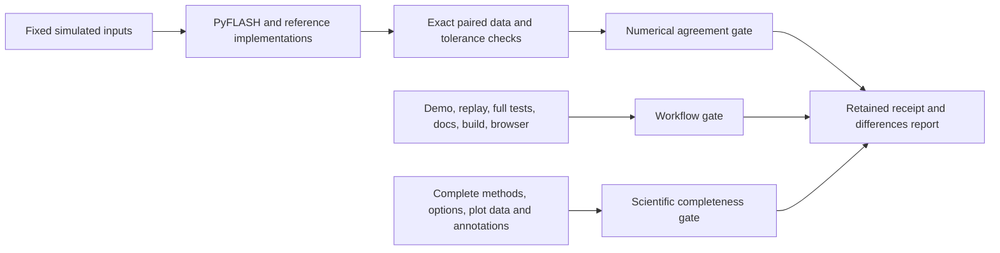

# Reproducibility checks — active alignment, 2026-10-04

## Consumed-input and current-render verification, 2026-10-06

The installed input repair passes 135 affected checks. CSV and pickle owners
verify the same captured bytes that they actually parse, then refuse a source
changed during loading or execution. Both interface script exporters and the
plain-English runner use those owners. Compressed CSV transport, bounded-memory
spill, read-only saved-state migration and interruption cleanup are retained in
`reproducibility/reference-sources/consumed-input-guards/`.

Current-render preview evidence passes 77 affected checks. Skipped/no-write
renders capture fresh data and identity while preserving the old carrier and
pending write ownership; written carriers retain their identity and are checked
for subsequent modification. This supersedes the earlier skip-preview identity
claim without rewriting its original evidence. Archive:
`reproducibility/reference-sources/current-preview-evidence/`.

Partial format sets now complete only when every cached carrier agrees with the
current science, source content, profile and producing options. Missing formats
reuse the cached identity and proof root; stale or inconsistent sets are refused
before writing. Both original failed cases now pass unchanged, and all 100
affected export/replay checks pass, including 23 new format controls. Those
controls cover both format orders, all three profiles, proof, cached identity
disagreement, changed proof geometry, pending ownership, public CSV companions
and the published profile API. Original failures and both failed proposals remain
in `reproducibility/reference-sources/partial-figure-formats/`.

The actual current global script builder passes eight unchanged guard branches
and six read-only loads with exact complete tables and consumed hashes. The two
original changed-ledger/artifact refusals pass. Six actual global preview
observer checks pass with the original pixel expectations and the revised
current-render identity contract. This checks transport and ownership, not new
plot/workbook computations. Archive:
`reproducibility/reference-sources/current-export-replay-20261006/`.

Workflow checkpoint and recovery checks pass 22 tests. Each full run writes its
starting source hashes, versions, owner and false verification gates before
execution; interruptions cannot look complete, and source changes fail every
run mode. The interrupted 2026-10-05 workflow remains explicitly failed with
retained logs and paired outputs. No complete scientific agreement is inferred
from its unfinished numerical stage. A replacement full workflow must pass on
the current source, including real-data performance and whole scientific
coverage, before whole-package alignment can be declared complete.

The command-shell background-startup fault has an installed six-case guard and
genuine ordinary version/import confirmations. A later processor-type Windows
management query stall was separately retained; the existing verification
launcher supplies native Windows metadata for its successful retry. This does
not establish an ordinary-process performance pass for that interrupted check.


## Fresh comparisons and export ownership, 2026-10-05

Seven installed registered families pass 5,627 fresh comparisons with unchanged
source: complete model records, estimator parameters, combined-parent intervals,
public mean bars, and the zero-feature, supplied-response and identical-row
ordered-category controls. This confirms their declared scopes; general model
fitting/search and undeclared plotting/parent options remain open.
Receipt: `C:/Users/Owner/AppData/Local/PyFLASH/alignment-families-20261005-v2/run.json`.

Workbook replay scripts now guard the statistics ledger and every existing
declared artifact alongside the consumed primary input. Both original omissions
are retained; two installed changed-input controls and eight existing actual
builder branches pass. Evidence: `reproducibility/reference-sources/workbook-replay-inputs/`
and `.runtime/workbook-replay-installed-confirmed/run.json`.

The plain-English runner's white PNG previews now leave through the existing
`PyFLASH.utils.save_fig` atomic writer. Six actual global-observer controls pass
with unchanged source and pixels, retaining one figure identity, exact data and
statistics, privacy profile, proof evidence root, and one montage/output event.
They cover saved, no-write, skipped, public, minimal-public and proof-enabled
figures. The affected export suite passes 66 tests; nine final preview controls
also check minimal-public proof, older-dependency compatibility and corrupt
primary-evidence refusal. Fourteen dependency profile controls pass. The local
ReproFig repair preserves already reduced table metadata during unchanged
transport; PyFLASH also uses its published embedding API so this preview does
not depend on that local repair being published.
Evidence: `reproducibility/reference-sources/figure-preview-owner/`,
`.runtime/preview-owner-published-api-proof-confirmed.xml`, and
`C:/Users/Owner/AppData/Local/PyFLASH/preview-owner-installed-confirmed-v2/run.json`.

The earlier interrupted full run remains failed and retained. The replacement
full workflow must check the current source, trusted real-data timings, browser,
replay, complete tests, documentation, distribution and scientific coverage.
Whole-package alignment remains active; no partial family promotes an unchecked
capability to complete.

## Installed repairs awaiting final replay, 2026-10-05

The identical-training-row fit repair adds 72 complete independently derived
positive-penalty controls, retaining all 72 original failures. All 466 affected
installed checks pass, preserving ordinary fitted arrays and earlier zero-feature
answers. The original model-record fixture and source manifest are unchanged;
15 identity/ownership controls verify the explicit accepted-adapter revision chain.
The first fresh family failed at this formerly stale adapter identity; its failed
receipt is retained, and the replacement replay still has to pass.

The ordered-category response repair passes 83 installed checks over 72 frozen
supplied-state cases and one-dimensional shape controls. Its candidate preserves
all 72 ordinary fitted reports exactly and the 108 zero-feature benchmarks.
Native floating-dot and subnormal disagreements remain diagnostics. Estimator
parameters, zero-feature fitting and supplied-state responses are separate registered
families; none certifies general model fitting/search.

All three script exporters share `PyFLASH._replay` guards for input content, code,
configuration and dependency versions. Forty affected export/recovery/fresh-process
checks and eight actual global-builder controls pass. Scripts retain the consumed
resident input hash and loading does not rewrite the source pickle. The new
`classification` extra and declared dependency-version receipts are installed.
Evidence: `.runtime/ordinal-response-shape-recovery-20261005.xml`,
`.runtime/shared-replay-installed-confirmed-20261005.xml`, and
`.runtime/global-replay-guards-confirmed-20261005-v2/run.json`.

The preceding full run has an explicit failed interruption receipt, preserving
completed numerical/stage evidence and the owned-process profile. Its model-record
test adapter unnecessarily copied unrelated retained records; the accepted state
ownership repair preserves complete answers and caller state. Fresh family replays
and the replacement full workflow remain required. The earlier receipts below
retain their original scope and source identity.

Automatic fitted-scope selection passes 720 complete fresh reports, and enabled
point effects pass 4,180 complete fresh reports after correcting extreme-scale
and near-equal measurement arithmetic. The archives retain 480 and 124 original
failures respectively; installed affected checks pass 6,963 tests. The accepted
fresh receipts have unchanged source; the first numerically agreeing point
replay with concurrent interface edits remains a failed source-integrity receipt.
Evidence: `.runtime/comparison-parent-auto-scope-fresh-integrated-confirmed/run.json`,
`.runtime/comparison-parent-effects-fresh-integrated-confirmed-v2/run.json`, and
`.runtime/comparison-parent-auto-effects-installed-confirmed.xml`.
Both rounds leave other combined-parent options open.

Functional correlation/model records and significance labels pass 233 complete
fresh cases, retaining 21 original failures. JSON-value and bounded table
summaries pass 78 complete fresh cases, retaining six failures. All six public
operations require all their cases; 4,415 installed affected checks pass.
Evidence: `.runtime/regression-records-fresh-integrated-confirmed/run.json`,
`.runtime/report-serialization-fresh-integrated-confirmed/run.json`, and
`.runtime/report-builders-serialization-installed-confirmed.xml`.
These supplied-input/schema checks do not certify fitted inference.

The installed interval repair passes all 86 complete common-draw intervals
against exact-moment/independent bootstrap equations, preserving 58 original
failures, 1,370 existing regressions and 4,180 point-effect parent reports.
Fresh captured-candidate replay passes without source changes:
`.runtime/scale-intervals-isolated-fresh-confirmed-v2/run.json`.
The live source-change failure and isolated missing-evidence failure are retained;
recovery restores only original hash-verified evidence. Combined-parent interval
integration and the current live interface remain separately gated.

All 7,787 complete supplied-record digests agree without a production change.
Installed checks pass 7,790 tests, and fresh replay preserves source identity:
`.runtime/record-digests-fresh-integrated-confirmed/run.json` and
`.runtime/record-digests-installed-confirmed.xml`.
Every digest is required by its public-operation gate.

The report collector passes all 481 fresh lifecycle, call-ownership and actual
figure-attachment traces after guarding an infinite record index. Original
32 failures and the unchanged first 465 cases remain archived. All nine public
lifecycle/attachment operations require their full declared cases; installed
report checks pass 8,626 tests. Evidence:
`.runtime/collector-fresh-integrated-confirmed/run.json` and
`.runtime/collector-all-report-installed-confirmed.xml`.

The documented development command passes 547 tests within its 30-second
budget in 10.655 seconds with no concurrent owned heavy job. The earlier
30.98-second miss and diagnostic profile remain preserved. Evidence:
`.runtime/development-after-families-sequential-confirmed/run.json`.

Audit-bearing records pass 3,096 fresh complete comparisons and 4,092 installed
affected checks. All accepted correction arrays are reused with exact identity;
no production edit was required. The builder completeness gate requires every
one of the 3,672 audited and unaudited cases. Combined-parent audit generation
still needs its own whole-report proof. Evidence:
`.runtime/comparison-record-audits-fresh-integrated-confirmed/run.json` and
`.runtime/comparison-record-audits-installed-confirmed.xml`.

Model-parent records pass 1,048 fresh complete returned/emitted/plotted-row
comparisons and 4,210 installed affected checks, preserving 797 original
failures and every earlier 508-case answer. Source identifiers remain intact
after filtering and with named, numeric or multi-level indices. Fresh replay
has no source changes. Evidence:
`.runtime/comparison-parent-records-fresh-integrated-confirmed/run.json` and
`.runtime/comparison-parent-records-installed-confirmed.xml`.
The earlier drawing/description/record repairs also preserve all parent/model
regressions: 6,921 checks pass in
`.runtime/report-helpers-parent-regressions-confirmed.xml`.

The previously timed-out native value-null stage now passes all 29 unchanged
queries, including the default 10,000-fit query, in 86.03 seconds under the
recorded 900-second deadline. Existing frozen full arrays and pinned runtime
identities agree; reference files remain unchanged. Evidence:
`.runtime/value-null-native-900-confirmed-v2/run.json`.
This resolves the isolated execution stage; a fresh final full-workflow run
remains required after all applicable coverage gates pass.

Unaudited structured comparison records pass 576 fresh full-field comparisons
and 1,045 installed affected checks, preserving 270 original failures. Tiny
differences, missing declared groups and tied means now produce consistent
direction/headline fields. Correction-audit and whole combined-parent emission
options remain active work. Evidence:
`.runtime/comparison-records-fresh-integrated-confirmed/run.json` and
`.runtime/comparison-records-installed-confirmed.xml`.

The two-factor design-cache round passes 720 fresh full warm/cached comparisons
and 1,167 installed affected checks, preserving all 240 original failures.
Group descriptions pass 369 fresh complete comparisons, preserving 101
original failures. Both replay receipts contain no source changes. Evidence:
`.runtime/comparison-parent-cache-fresh-integrated-confirmed/run.json`,
`.runtime/comparison-parent-cache-installed-confirmed.xml`, and
`.runtime/group-descriptions-fresh-integrated-confirmed/run.json`.
Other combined-parent options and public report operations remain required by
the final whole-package gate.

Comparison drawing passes all 388 fresh complete helper comparisons with no
source changes, retaining 186 original failures and all six before-correction
reference revisions. The independent answer includes every error-bar and
bracket coordinate, text, colour, anchor, axis limit and return value. Positive
uncertainty at tiny scales uses zero absolute tolerance. Evidence:
`.runtime/comparison-geometry-fresh-integrated-confirmed/run.json` and
`.runtime/comparison-geometry-installed-confirmed-v2.xml` (478 passing checks,
one stale exact-fit model assertion subsequently corrected against its frozen
independent report and passed in
`.runtime/comparison-geometry-recovery-confirmed-v2.xml`). Whole combined-parent
output, drawing, cache, effect and audit coverage remains active work.

The model-scope round passes all 1,284 fresh complete returned reports and
6,362 installed regression checks. All 1,024 original failed reports and every
supplied plot-array request remain archived. Normality, variance screening and
model inference now refer to the same retained outcome rows from the declared
model data or two-factor experiment summary. The proposed correction preserves
all 4,180 earlier combined reports. Evidence:
`.runtime/comparison-parent-model-scope-fresh-integrated-confirmed/run.json` and
`.runtime/comparison-parent-model-scope-installed-confirmed.xml`.

The routing round passes 2,162 fresh complete returned-report comparisons and
4,981 installed regression checks, with all 467 original failed reports retained.
Finite observations retain their declared group positions, and two-group tests
keep explicitly empty/reversed/repeated selections. The stable published
Kolmogorov-Smirnov upper branch is checked by 270 additional 500-digit witnesses,
including positive subnormal tails. All earlier answers remain unchanged. The
original pooled-normality family also passes 173 fresh comparisons; its whole
capability gate additionally requires the 270 new witnesses. The routing family
freshly replays all nine unchanged native R range inputs before comparing its
complete reports. Evidence:
`.runtime/comparison-parent-routing-fresh-integrated-confirmed/run.json`,
`.runtime/comparison-parent-routing-installed-confirmed-v2.xml`, and
`.runtime/normality-after-stable-KS-fresh-confirmed/run.json`.

Combined group-comparison inference passes 2,018 fresh source-guarded complete
returned-report comparisons and 3,706 affected regression checks. The immutable
before-correction evidence retains 1,050 original failures. Explicitly empty,
reversed and repeated multi-group pair requests now survive the parent function;
disabled permutation analysis reports the correct unavailable reason. The
`group-comparison-inference` family retains all independent reference answers,
original application outputs and the failed first proposal. Remaining parent
options, including automatic/two-group routing and missing-group positions,
are not certified by this round. Evidence:
`.runtime/comparison-parent-inference-fresh-integrated-confirmed/run.json` and
`.runtime/comparison-parent-inference-installed-confirmed.xml`.

Complete pooled-normality reports pass 173 fresh source-guarded comparisons,
retaining 98 original failures across 124 whole reports. All histogram and
quantile coordinates are checked alongside the four tests and verdict. The
existing fitted-normal/association family passes 229 fresh comparisons after
the numerical balancing change. The corrected independent Kolmogorov-Smirnov
matrix construction was frozen before production edits; its failed reference
and all earlier answers remain preserved. Native R/fBasics retains 49
corroborations and 18 diagnostics; large-sample exact native KS queries that
exceeded the 900-second limit are retained without agreement votes. Complete
mathematical checks still include both 5,000/5,001-observation boundaries.

The first integration round retains 1,558 passing tests and the constant-marker
pipeline failure. A separate twelve-case functional repair excludes constant
tested markers and fixes the secondary-bar call's public argument binding.
The installed recovery passes all 1,572 affected checks and twelve fresh
source-guarded functional comparisons. An actual bar-export test also passes
using the public DataFrame interface. This supplies no full scientific-pipeline
claim; its complete parent contract and the final whole workflow remain required.

Subsequent source-guarded report replays agree on 278 Mann-Whitney comparisons,
205 caption/CSV contracts, 1,163 ordinary analysis-of-variance comparisons,
364 unequal-variance comparisons, 65 extreme-finite-input reports and 1,624
Student/variance comparisons. Original failing inputs and answers are retained.
Finite inference is evaluated before a statistic is rounded or overflows its
display representation. Complete rank reports now retain 1,220 independent
answers and 1,123 original failures; all 1,773 installed checks and 1,317 fresh
mathematical/native comparisons pass with zero source changes.
These family receipts do not replace the pending whole-workflow receipt.

Complete two-factor reports now pass 2,849 affected tests and 485 fresh
source-guarded comparisons. Their 394 reports and 26 complete Tukey matrices
retain all 322 original failures. Every factor sum of squares, F statistic,
degree of freedom, probability, matrix cell and ordered report field is checked.

The exported rank correction audit passes a fresh replay of all 628 complete
reports, retaining 109 original failures. Its affected suite passes 2,921 checks;
the one outdated deadline-dependency fingerprint is corrected through preserved
fixture lineage, with all 645 correction/recovery checks passing and every
numeric answer unchanged. Fraction-backed rank caches use the shared measured
memory bound and pass 1,750 ownership/regression checks.

Complete covariate-adjusted model reports pass 461 affected tests and 300 fresh
source-guarded mathematical/native comparisons. Their 295 reports retain 227
original failures. Every correction, covariance family, inference distribution,
inference degree of freedom, omission scope, grouping-array alignment and
declared zero/small-error case is checked. Five unchanged published R coefficient
and covariance matrices are corroborations; derived inference adds no extra
native kernel vote. These proofs do not replace the pending final whole workflow.

Complete public Bonferroni/Sidak scalar domains pass 2,872 affected checks and a
fresh 202-comparison replay. All 78 original failures remain frozen. The first
installed integration failure and successful report-wrapper recovery are both
retained; undefined parent probabilities remain undefined. Positive tails use
zero absolute tolerance, including subnormal inputs with enormous whole counts.

The later control/slope whole-run receipt failed when the complete 10,000-fit
native value-null reference exceeded its 180-second deadline. It recorded zero
source changes and ran no executable workflow stages. The unchanged query now
has a recorded 900-second deadline. A reference failure no longer prevents
independent test/build/browser checks from running; both errors remain failures.

Subsequent complete functional significance/cache corrections pass 640 affected
tests, 513 parent/completeness checks and a fresh 509-comparison replay. Complete
variance/Student reports retain 632 original failures, pass 1,897 affected tests
and a fresh 1,624-comparison replay. Eleven revised cost/completeness/execution
checks pass. The actual documented development command passes 547 focused tests
in 14.19 seconds overall, within the unchanged 30-second budget. These focused
rounds await a current integrated workflow.

The earlier successful unchanged-source full workflow passes 10,402 comparisons
and 10,456 tests without skips. All executed demo, README, replay, documentation,
build, browser, appearance, layout, timing and isolated dependency-repair stages
pass. Scientific completeness remains failing: 95 contracts are complete and
148 are incomplete in that receipt. Its source remains unchanged throughout:
`C:/Users/Owner/AppData/Local/PyFLASH/image-bootstrap-full-20261004/20261004T194517211272Z/run.json`.

Later installed corrections pass 193 normality/association checks, 3,663 outlier
checks, 1,185 effect-report checks and 151 growth/statistics checks. Fresh independent
comparisons pass for 75 normality inputs, 84 association schemas, 86 complete growth
fits, 4,224 outlier arrays/report comparisons and 540 complete effect reports.
Original failing answers and unsuccessful corrective proposals remain retained.
These later focused proofs await their next integrated workflow and do not
certify the unchecked analyses or options.

The preserved legacy Mann-Whitney label now has 600 complete report comparisons,
all passing, and 786 affected report/classification tests pass. On 2026-10-05 the
deterministic control-comparison and exact binary-scaling correction was installed
after 2,380 proposal comparisons and 67 larger-group, quadrature-witness and legacy
parent checks agreed. Permanent references retain all 1,164 control reports and
16 extreme-unit cases, with every earlier failing answer preserved. The installed
affected suite passes 2,634 tests, with its obsolete completeness assertion fixed
and checked separately; 160 classification checks and 1,180 fresh comparisons
pass. Complete slope contrasts additionally pass 1,175 installed checks against
948 independently frozen mathematical reports and 816 corresponding native-R
fits. Its fresh replay passes all 1,764 comparisons with unchanged source after
a retained Dropbox progress-file lock failure. Forty-two functional shape cases
retain 36 original failures; all 1,367 affected checks and 42 fresh comparisons
pass. Deferring model/rendering imports passes 119 affected checks. These
additions await their integrated whole workflow. The development
loop currently passes its 548 checks but misses the 30-second budget; profiling
and correction continue.

## Historical verification rounds

The subsequent public rhythm-table correction has 222 frozen complete rows and
independent raw-input native-R comparisons, preserving 48 original failures.
Its child numerical answers are composed only when retained inputs match existing
independently frozen references. Mixed-model references cover 30 interior/zero
random-variance cases, three exact designs with no finite Gaussian variance
solution and 18 small-positive-variance cases. All use unchanged coefficient
tolerances and zero absolute tolerance for positive significance probabilities.
The integrated follow-up passes 331 affected checks and strict documentation
builds successfully. The next unchanged-source numerical workflow passes all
7,112 comparisons, recording 87 complete contracts and 156 remaining gaps;
its workflow stages were unrequested. Receipt:
`C:/Users/Owner/AppData/Local/PyFLASH/public-rhythm-numerical-20261004/20261004T182140306562Z/run.json`.
the full receipt below predates these changes. Wald significance is asymptotic.

Later image input corrections pass 2,802 affected checks, including receipt
events, microscopy import and UI display. The 2,772 frozen functional cases
cover literal pixels, metadata, previews, decoder choices and worker controls;
152 encoded input files now participate in the source guard. Stored 16-bit and
floating grayscale intensities are preserved. The next integrated receipt is
pending; shared decoder/interpolation kernels add no independent science vote.

Full bootstrap interval options agree with 518 independent analytic cases;
682 related checks and both execution-error checks pass. Invalid options now
raise before sampling instead of changing the estimator or rounding counts.
The next full workflow includes these later corrections and retained failures.

The latest unchanged-source **full** workflow passes **6,361 numerical
comparisons and all 6,668 tests**, with no skips or source changes. The inventory
has **85 complete contracts and 158 declarations awaiting complete coverage**.
Demo, README example, fresh replay, strict documentation, distributions,
browser interactions, appearance, desktop/narrow layouts, comparison views,
both timing budgets and isolated dependency repair pass. Scientific completeness
still fails, and the task remains active.

The example draws plots in 4.586 seconds and redraws subject selection in
0.334 seconds. Real-data plots take 4.715 seconds; selection takes 0.345 seconds
idle and 0.313 seconds during processing. Limits remain five seconds and half
a second. These are actual rendering boundaries, not server-ready timings.

Evidence: [latest full receipt](<C:/Users/Owner/AppData/Local/PyFLASH/correction-reports-full-20261004/20261004T161936991726Z/run.json>),
[paired comparisons](<C:/Users/Owner/AppData/Local/PyFLASH/correction-reports-full-20261004/20261004T161936991726Z/comparisons.csv>),
[test results](<C:/Users/Owner/AppData/Local/PyFLASH/correction-reports-full-20261004/20261004T161936991726Z/tests.xml>) and
[differences/coverage](<C:/Users/Owner/AppData/Local/PyFLASH/correction-reports-full-20261004/20261004T161936991726Z/DIFFERENCES.md>).

Later group rhythm fixes have 57 complete frozen cases, with 52 raw-input native-R
equivalents and independent 80-digit inference. Invalid periods and ambiguous
labels fail before fitting; missing/nonfinite rows are omitted and exact-fit
significance is explicit. Population amplitude uncertainty agrees over 51
complete branch cases, with 48 published-native-R equivalents. Free-period
coefficient averaging is rejected. All 223 affected rhythm checks pass. This
branch coverage leaves the complete parent table awaiting its other methods.
These later fixes await their next full-workflow receipt. Positive probabilities
in these new contracts additionally require relative agreement with zero
absolute tolerance, preventing a tiny positive probability being accepted as zero.

Complete permutation distributions and attainable probability floors agree over
34 designs with unchanged pinned published R kernels and exact-fraction/70-digit
inference. Sampled arrangements share recorded NumPy draws; this supplies no
independent random-generator vote. All-tied designs are undefined, not perfectly
significant. One-based pair extraction and published magnitude labeling are
complete functional contracts, separately labeled from parent inference.
Cached result paths move with their project; container types, external paths,
labels and measurements survive. Later retained-cache memory bounds require
the next full-workflow proof. A numerical-only receipt leaves its workflow gate
unrequested rather than reporting an empty list of workflow stages as a pass.

Selected exponential and logistic fits now contribute sixteen complete-output
comparisons on four noisy rising/falling patterns, including unsorted missing
inputs. Native R symbolic Hessians and covariance agree with a separate 60-digit
objective benchmark. This is mathematical agreement on the selected models;
automatic selection, other candidate fits and degeneracies remain incomplete.
The latest round ran numerical references only, not the full browser workflow.

Earlier full attempts and their failures remain retained. The previously
outdated loader stand-in and unnamed native download control are corrected and
pass in the latest full run. Historical focused proofs below are also included
in that run unless explicitly marked as later changes.

Later full-output cosinor references cover fixed and profiled free periods,
all uncertainty fields and held-out predictions over 47 cases, with 40 native-R
equivalents and separate 70-digit mathematics. Direct and column-aligned minP
correction each have 84 frozen references. Sampled probabilities include the
observed arrangement; missing tests stay undefined. Sixty independent discrete
calibration checks reject interpolation across a probability mass jump and
preserve an unattainable cutoff in exports. Calibration is explicitly selected
field coverage, not a complete audit or sampling-design validation. The combined
focused scientific checks pass 556 tests. These later additions still require
their final full-workflow receipt; the numerical-only round above includes them.

The complete value-based Fisher-LSD null has 29 frozen native-R and separate
rational/70-digit references. Every probability, pair and mode/count field is
retained, with common NumPy arrangements explicitly labelled. Four original
all-equal failures remain frozen; zero residual variance and equal means are
undefined, not perfectly significant. Invalid groups, counts and seeds now
fail before random sampling. The focused checks pass 427 tests, and the numerical
round above includes all complete cases. Final workflow confirmation remains pending.

Circular reference answers were frozen before production changes. Native R
executes the pinned published circular 0.5-2 probability kernel; Astropy 8.0.1
supplies a separately implemented equivalent; an 80-digit formula is a distinct
mathematical benchmark. The original frozen regression has 108 failures and
432 passes. The correction reduces repeated cycles before angle conversion,
omits missing/nonfinite values, treats an effectively zero resultant mean as
undefined, and applies the finite-sample correction only below 50 observations.
It preserves every previously accepted descriptive answer. Permanent tests and
continuous integration now include all 540 independent circular comparisons.

Circular-linear correlation compares all four returned fields against native R,
Statsmodels and independent 80-digit least squares over 48 cases. Pairwise
missingness, modulo reduction and perfect-fit significance are corrected without
changing the two-predictor F-test definition or comparison tolerance.

Watson-Williams inference compares every statistic and all phase coordinates
over 60 cases against native R and 80-digit mathematics; 54 cases also agree
with PyCircStat2 0.1.15. The six remaining package results are verified degenerate
roundoff artifacts and remain visible in the outcome grid and raw paired data.
The pooled-concentration R convention is retained as a separate diagnostic.
The correction evaluates resultant differences without cancellation, preserves
constant-group means and treats zero resultants as undefined directions.
Original failures and source copies remain in
`.runtime/watson-williams-first-round/` and `.runtime/watson-williams-before.xml`.

## Historical full round — retained, superseded by the evidence above

All **1,100 package tests** pass with no skips, and all **141 numerical reference comparisons** agree within the unchanged relative 1e-9 / absolute 1e-12 tolerance. Maximum absolute numerical error: `1.2221335055073723e-12`. Source changes during this full run: zero.

Demo, unchanged README example, unchanged exported-script replay, strict documentation, isolated distribution builds, actual browser interactions, both themes and desktop/narrow layouts pass. Full scientific coverage remains incomplete; the inventory links executed partial contracts rather than calling an entire parent method validated.

First usable plots: **8.537 seconds** against 5 seconds. Linked subject redraw after painting both views: **1.346 seconds** against 0.5 seconds. Performance gate: **fail**. Complete scientific gate: **fail**, 242 inventoried contracts remain incomplete. The strict command returns 1 while either required gate fails.

- [Source-stable full receipt](<C:/Users/Owner/AppData/Local/PyFLASH/workflow-driver/20261004T004933007521Z/receipts/20261004T004933939218Z/run.json>)
- [Differences and remaining coverage](<C:/Users/Owner/AppData/Local/PyFLASH/workflow-driver/20261004T004933007521Z/receipts/20261004T004933939218Z/DIFFERENCES.md>)
- [All paired numerical values](<C:/Users/Owner/AppData/Local/PyFLASH/workflow-driver/20261004T004933007521Z/receipts/20261004T004933939218Z/comparisons.csv>)
- [Capability/option map with executed partial contracts](<C:/Users/Owner/AppData/Local/PyFLASH/workflow-driver/20261004T004933007521Z/receipts/20261004T004933939218Z/capabilities.csv>)
- [Outcome grid](<C:/Users/Owner/AppData/Local/PyFLASH/workflow-driver/20261004T004933007521Z/receipts/20261004T004933939218Z/outcome-grid.csv>)
- [Full test results](<C:/Users/Owner/AppData/Local/PyFLASH/workflow-driver/20261004T004933007521Z/receipts/20261004T004933939218Z/tests.xml>)
- [Browser checks](<C:/Users/Owner/AppData/Local/PyFLASH/workflow-driver/20261004T004933007521Z/receipts/20261004T004933939218Z/browser/browser-checks.json>)

## Corrections verified in this round

The outlier-bound function included positive/negative infinity despite promising finite observations. On frozen `[1,2,3,4,+inf,-inf]`, the 1.5-interquartile-range bounds changed from `[-2.5,7.5]` to the independent `[-0.5,5.5]`. Modified z-scores now preserve missingness at both infinite cells, and grouped flagging excludes those observations.

The linear growth fit used SciPy numerical derivatives despite being linear in its parameters. Both Statsmodels ordinary least squares and the separately implemented 50-digit analytic solution supported the same correction. A direct least-squares fit now agrees for both coefficients, their standard errors, fit statistics and every prediction; original tolerances and independent fixtures are unchanged. Singular linear designs cannot identify both coefficients.

First failing comparisons are preserved at `C:/Users/Owner/AppData/Local/PyFLASH/check-completion-references/20261004T000734288833Z`; the second independent linear calculation before the fix is at `C:/Users/Owner/AppData/Local/PyFLASH/check-completion-second-reference/20261004T001012204030Z`. Their original unresolved reports are retained; the causes above were verified in later passes.

The normal browser launch disables imported-file source scanning and table browsing no longer imports microscopy processing just to read a missing-value tag. `pyflash-ui --dev -- --demo` retains automatic source reload for development. Browser checks now own the actual server, refuse occupied ports and retain its process identity and closure receipt. Earlier checks that used a parent launcher may have reached a retained child server; they do not establish final performance.

## Scope and retained evidence

The extra contracts cover correlation differences and asymmetric intervals, variance effects, intraclass correlation, outlier arrays, descriptive circular statistics and linear predictions. Circular descriptions do not validate Rayleigh probabilities; linear agreement does not validate nonlinear/automatic growth fitting. Plot coordinates, uncertainty bands, annotations, full pipelines and all exposed options still need independent coverage.

The conservative inventory contains support methods and properties as well as scientific functions and plot aliases. Its row count is not a count of distinct algorithms. Every row remains incomplete until the applicable whole-call contract is covered; the executed subsets are linked separately.

The tested fresh-server isolation repair is recorded in the software-development experience guide, with its completed occupied-port check. It does not certify whole-library correctness. No shared skill wording was edited. No release, commit or publication was performed.

## Temporary-file cleanup

Automatic approval review rejected removal of this run's verified temporary test directory (`C:/Users/Owner/AppData/Local/Temp/pyflash-_sdn7bw7`) with “blocked by policy”. Its 15,724,693 bytes remain. No alternative deletion route was attempted.

## Latest measured layout

Window 1440x900:

| Check | Measured | Limit | Result |
|---|---|---|---|
| Image/plot area of first screen | 68% | >= 67% | pass |
| Largest gap between neighbouring views on first screen (px) | 0.0 | <= 8 | pass |
| Worst dead space inside a card on first screen | 0% | <= 25% | pass |
| Pixels above the first view | 80.1 | <= 120 | pass |
| Worst letterboxing inside an image | 0% | <= 10% | pass |
| Overlapping text labels | 0 | <= 0 | pass |
| SVG labels crossing their canvas edge | 0 | <= 0 | pass |
| Controls without a tooltip | 0 | <= 0 | pass |

Window 800x900:

| Check | Measured | Limit | Result |
|---|---|---|---|
| Image/plot area of first screen | 67% | >= 67% | pass |
| Largest gap between neighbouring views on first screen (px) | 0.0 | <= 8 | pass |
| Worst dead space inside a card on first screen | 0% | <= 25% | pass |
| Pixels above the first view | 76.9 | <= 120 | pass |
| Worst letterboxing inside an image | 0% | <= 10% | pass |
| Overlapping text labels | 0 | <= 0 | pass |
| SVG labels crossing their canvas edge | 0 | <= 0 | pass |
| Controls without a tooltip | 0 | <= 0 | pass |

The actual light, dark and narrow browser screenshots were inspected. These are verification evidence, not an inferred user visual approval.

A prior stable attempt at `C:/Users/Owner/AppData/Local/PyFLASH/reproducibility/20261004T003314611852Z` retained five child-interpreter startup failures and a closed interactive-output error. All five focused checks subsequently passed; the completed full run above uses a persistent output file and passes all 1,100 tests. No assertion was weakened.

## Earlier full run (retained)

# Software alignment and reproducibility review — 2026-10-04

The checked statistical contracts, numerical demo and unchanged browser-backend
script replay work. Whole-package software-development alignment and complete
independent scientific validation remain partial.

The full workflow finished against a stable source snapshot in
`C:/Users/Owner/AppData/Local/PyFLASH/reproducibility/20261003T232929717672Z`.
All 1,014 package tests passed, with no skips or failures. All 61 executed
reference comparisons agree within the combined declared tolerances; maximum
absolute error is `1.2221335055073723e-12`. Source changes during the run: zero.
The command returned exit code 1 because browser speed targets and scientific
completeness remain failing. This is not a whole-package alignment pass.

## Final executed workflow

```powershell
cd 'C:/Users/Owner/UK Dementia Research Institute Dropbox/Brancaccio Lab/Jamie/Experiments/IHF Pipeline/IF_analysis'
python -m reproducibility.run --full --require-complete --output "$env:LOCALAPPDATA/PyFLASH/reproducibility" --port 8531
```

- Numerical agreement: **pass**, 61 comparisons.
- Full package tests: **pass**, 1,014 tests; pytest time 593.525 seconds.
- Demo, unchanged README example and exact fresh-process script replay: **pass**.
- Strict documentation and isolated source/wheel distribution builds: **pass**.
- Actual browser interactions, all eight routes and both layout sizes: **pass**.
- Browser performance gate: **fail**, both measured budgets missed.
- Scientific-completeness gate: **fail**, 242 inventoried full contracts remain incomplete.
- Overall workflow gate: **fail**, because its performance stage failed.

Original evidence:
[receipt](<C:/Users/Owner/AppData/Local/PyFLASH/reproducibility/20261003T232929717672Z/run.json>),
[differences report](<C:/Users/Owner/AppData/Local/PyFLASH/reproducibility/20261003T232929717672Z/DIFFERENCES.md>),
[paired numerical values](<C:/Users/Owner/AppData/Local/PyFLASH/reproducibility/20261003T232929717672Z/comparisons.csv>),
[capability inventory](<C:/Users/Owner/AppData/Local/PyFLASH/reproducibility/20261003T232929717672Z/capabilities.csv>),
[complete outcome grid](<C:/Users/Owner/AppData/Local/PyFLASH/reproducibility/20261003T232929717672Z/outcome-grid.csv>).

Executed environment: Python 3.12.10; PyFLASH-analysis 0.2.0; NumPy 2.1.0;
pandas 2.2.2; SciPy 1.14.1; statsmodels 0.14.2; Pingouin 0.5.5; mpmath 1.3.0;
ReproFig 0.5.1; Streamlit 1.58.0; pytest 9.0.2; uv 0.11.28.
The checkout is intentionally uncommitted; its starting commit is
`632dd75b07b4894cf4c6912fc34da62900352f94`. Exact source fingerprints identify
the tested candidate separately from that commit.

## Browser budgets and layout

The browser starts from a fresh owned server and recovery directory. First
screen timing ends only when both actual plots contain data marks. Subject
timing starts at the actual click and ends after both views redraw; the value
below is the median of five repetitions. Other projects were running on this
machine; their presence does not convert a missed target into a pass.

| Boundary | Measured | Required | Outcome |
|---|---:|---:|---|
| Load until both first plots are drawn | 8.726 s | <=5.000 s | fail |
| Subject selection until both views redraw | 0.610 s | <=0.500 s | fail |

Desktop layout audit, 1440 x 900:

| Check | Measured | Limit | Result |
|---|---|---|---|
| Image/plot area of first screen | 68% | >= 67% | pass |
| Largest gap between neighbouring views on first screen (px) | 0.0 | <= 8 | pass |
| Worst dead space inside a card on first screen | 0% | <= 25% | pass |
| Pixels above the first view | 80.1 | <= 120 | pass |
| Worst letterboxing inside an image | 0% | <= 10% | pass |
| Overlapping text labels | 0 | <= 0 | pass |
| SVG labels crossing their canvas edge | 0 | <= 0 | pass |
| Controls without a tooltip | 0 | <= 0 | pass |

Narrow layout audit, 800 x 900:

| Check | Measured | Limit | Result |
|---|---|---|---|
| Image/plot area of first screen | 67% | >= 67% | pass |
| Largest gap between neighbouring views on first screen (px) | 0.0 | <= 8 | pass |
| Worst dead space inside a card on first screen | 0% | <= 25% | pass |
| Pixels above the first view | 76.9 | <= 120 | pass |
| Worst letterboxing inside an image | 0% | <= 10% | pass |
| Overlapping text labels | 0 | <= 0 | pass |
| SVG labels crossing their canvas edge | 0 | <= 0 | pass |
| Controls without a tooltip | 0 | <= 0 | pass |

Both tables are pasted from the retained measurement logs. Actual light, dark
and 800-pixel screenshots were visually inspected: sidebar labels fit, plots
retain equal data heights, narrow comparisons stack and there is no horizontal
overflow. No accepted visual reference was supplied, so no reference-match
claim is made. These measurements certify the exploration page only.

[Browser report](<C:/Users/Owner/AppData/Local/PyFLASH/reproducibility/20261003T232929717672Z/browser/browser-checks.json>)
retains linked dropdown/point selection, independent view metrics, theme checks,
navigation and reopened subject state. Focused worker tests cover stale-result
rejection, retry, dataset ownership and interface changes without starting analysis.

## Evidence scope

Like a calibration certificate, this evidence names the measurements it checks.
A passing reference for a statistical subroutine does not certify every plot
that uses it. The workflow keeps these gates separate:



The input examples contain no biological claims. Relative tolerance is `1e-9`
and absolute tolerance is `1e-12`; shapes and missingness must also agree.
The workflow retains input/code/output fingerprints, software versions, commit,
uncommitted changes, source copies, exact paired arrays and failed stages.
Changes to checked source during a run invalidate its workflow gate.

## Handled, no action needed

- Schema versions, legacy migration and atomic replacement of scientific state.
- Shared strict action dispatch, installable command-line control and discoverable help.
- Per-call batch progress, output verification, resume, retry and failure summaries.
- Input/configuration/code identities in exported scripts and execution records.
- Deterministic subject-bootstrap draws and cache invalidation when seed/settings change.
- Vectorized Cohen/Hedges estimation with preserved scalar definitions and interval endpoints.
- Lightweight package import with historical public aliases retained in the source catalogue.
- Native light/dark background and narrow stacked exploration without clipped sidebar labels.
- Permanent independent-reference tests and a continuous-integration workflow definition.
- Preserved pre-existing edits and one reusable Research Gallery work package.

## Scientific comparisons

The 61 executed reference comparisons cover selected contracts for independent
Student/Welch tests, Cohen/Hedges and rank effects, five multiple-testing
corrections, fixed-period cosinor fits and bootstrap interval endpoints. The
complete paired arrays and field lists are in the run's `comparisons.csv` and
`paired-data.json`; no scientific plot equivalence is inferred from a screenshot.

Statsmodels implements pooled and unequal-variance two-sample estimates and
reports statistics, probabilities and degrees of freedom. The actual executed
version is 0.14.2, as recorded locally; the current documentation is only method
orientation. [Statsmodels method documentation](https://www.statsmodels.org/stable/generated/statsmodels.stats.weightstats.ttest_ind.html).

Independence is labelled separately for every row. SciPy t-tests are shared-engine
integration checks. Statsmodels estimates share SciPy probability tails; the
50-digit mpmath formula checks those tails independently. Pingouin effect
estimates and direct mathematical/pair-enumeration benchmarks are separate.
Cosinor's statsmodels reference shares numerical linear algebra and SciPy
distributions; that dependency prevents claiming wholly independent inference.
Pingouin's alternative t-test calls SciPy and supplies no extra independent vote.
[Pinned Pingouin 0.5.5 source](https://github.com/raphaelvallat/pingouin/blob/v0.5.5/src/pingouin/parametric.py).

The independent bootstrap benchmark calculates the bias correction and
jackknife acceleration itself and uses Python's normal distribution quantiles.
It checks 12 contracts: three subject datasets, two effect estimators and two
confidence levels, using 400 draws and seed 17. Only NumPy's random draws are
shared with production. The production definition remains SciPy's
bias-corrected and accelerated interval for independently resampled subjects.
[Executed SciPy 1.14.1 method documentation](https://docs.scipy.org/doc/scipy-1.14.1/reference/generated/scipy.stats.bootstrap.html).

## Replay correction and speed evidence

An unseeded initial replay returned matching test results but different
bootstrap interval endpoints. The original paired reports remain in
`C:/Users/Owner/AppData/Local/PyFLASH/replay-review`. Repeating the same call
with a recorded seed reproduced every result/report field; that evidence
remains in `C:/Users/Owner/AppData/Local/PyFLASH/replay-seeded-20261003`.
The original six-subject-per-group Hedges intervals were dimensionless:
`Signal_MeanIntensity` changed from `[-12.225274666447138, -7.376428273707635]`
to `[-12.052015823754276, -7.228230174348134]`; `DAPI_MeanIntensity` changed
from `[-1.6264695008117271, 0.9168088340261383]` to
`[-1.6129273193158051, 0.9103306902782873]`. The test statistics agreed.
Exact replay required identical draws; no comparison tolerance was widened.
The configuration now defaults subject-bootstrap draws to seed zero, includes
that seed in exported settings, and invalidates cached statistics when it changes.
This deliberately fixes the draw identity; it does not change the estimator or
interval definition. The full-run replay executes the exported script unchanged
in a fresh process, checking all returned cells and both complete metric reports.
It certifies this mean-bar backend export, not every GUI result or saved figure.

The paired performance experiment retains 18 alternating baseline/candidate
runs across balanced, unequal and tied groups, Cohen and Hedges estimators,
5,000 draws, seed 17 and 95% confidence. Every interval endpoint matched exactly;
the slowest measured speedup was 95.7 times. This applies to these estimator
calls, not whole-application startup. Baseline source, candidate fingerprints,
profile and timings remain in
`C:/Users/Owner/AppData/Local/PyFLASH/bootstrap-performance-20261004`.

Startup profiles retain actual import/render work before and after removing
unnecessary microscopy/scientific imports. Profiling overhead and other running
projects make those observations unsuitable as a paired speedup claim.
The final unprofiled cold browser timing is the budget evidence.

## Remaining alignment limits

The full bullet-by-bullet audit is in
[software-development-alignment.md](software-development-alignment.md).
The scientific-completeness gate stays false: 242 inventoried complete callable
or registered plot/pipeline contracts lack full independent option, coordinate,
uncertainty and annotation coverage. This inventory records specified public
scientific modules and registered plots; it is not proof that every unregistered
plotting helper has been mapped. No public real-data comparison is claimed.

Other open requirements include all non-analysis UI actions sharing the same
dispatcher, universal one-click dependency repair, complete appearance/sweep
coverage, hundreds-of-items browser inspection, complete legacy pickle path
portability and input-verified factory caches. Resume is between registered
calls; concurrent queue writers and internal algorithm checkpoints are unverified.
An accepted visual reference and microscopy-specific comparison were not supplied.

## Retained earlier passes

Earlier full and partial runs remain under the same local verification parent,
with their source snapshots, logs and failure reports. They include the initial
unseeded replay, browser selector/routing failures and a catalogue alias failure.
Runs performed while source fixes were being applied are investigation evidence,
not an accepted source-stable final workflow. No failed receipt was overwritten.

## Reusable workflow and skill proposal

`python -m reproducibility.run --full --require-complete` performs the complete
available local workflow and preserves a new timestamped pass. The reference
and workflow tool requirements are pinned separately. Microsoft Edge and the
installed software-development layout tool are explicit browser prerequisites.
Windows Store Python uses uv's isolated distribution build to avoid its activation
alias in build-created environments; numerical checks keep their original Python.

Future proposal: after the open gates close, `/skill-tuner learn` could reference
this tested runner as a reusable
example of separate agreement, source-stable workflow and scientific completeness
gates. The example must retain its incomplete coverage warning. No shared skill
wording was edited. No publishing, commit or Graphify refresh was performed.

## Cleanup and retained evidence

All 48 recorded output fingerprints were checked after completion with zero
mismatches. The owned verification servers were stopped; ports 8527, 8529,
8531, 8537 and 8547 have no remaining listener from this work. No large Dropbox
inputs were downloaded, so there is no source-data online-only operation to perform.

The final run's temporary pytest folder contains 1,420 files totaling
15,734,138 bytes. Its absolute path was checked inside the owned run and no
reparse links were found. Automatic approval review rejected its removal,
stating "blocked by policy". It remains preserved; all original scientific
inputs, failed attempts, logs and accepted verification evidence remain intact.
