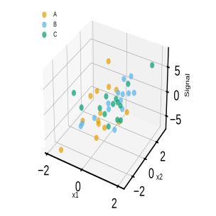

# plot_scatter_3d

## Summary

`plot_scatter_3d` draws three numeric summary columns on a 3D scatter plot. It
can save one figure per condition or factor level, overlay all groups on one
combined axis, queue over several x/y/z column combinations, and share axis
limits across queued sibling plots.

Registry name: `scatter_3d`.

## Example figure

<!-- gallery-example-code:start -->
Gallery render call (after `ex = build_example_data(fig_path=TMP)`, `exp = ex.experiment`, and `P = PyFLASH.plotting`):

```python
P.plot_scatter_3d(exp, x="x1", y="x2", z="Signal", combine=True, save=True)
```
<!-- gallery-example-code:end -->



*`x1`×`x2`×`Signal` in 3D, coloured by group. Rendered from the [synthetic example dataset](../examples/README.md).*

## Signature

```python
plot_scatter_3d(
    experiment,
    x,
    y,
    z,
    by="conditions",
    factor=None,
    specificity=None,
    filter_by=None,
    roi=None,
    save=True,
    combine=False,
    x_range=None,
    y_range=None,
    z_range=None,
    xmin=None,
    xmax=None,
    ymin=None,
    ymax=None,
    zmin=None,
    zmax=None,
    normalize_x=False,
    normalize_y=False,
    normalize_z=False,
    point_size=None,
    size_by=None,
    size_factor=1.0,
    alpha=None,
    elevation=None,
    azimuth=None,
    figsize=(10, 8),
    share_axes=True,
    point_edge=None,
    point_linewidth=None,
    column_labels=None,
    interactive=False,
)
```

## Input Object Types

| Object type | Accepted? | Notes |
|---|---:|---|
| `Batch` | Yes | Main supported input. Uses summary tables, condition metadata, and figure paths. |
| `Experiment` | Yes | Works when it exposes the same summary and condition attributes. |
| `MiniExperiment` | Usually | Works after processing into a PyFLASH-like object with summary columns and conditions. |
| `pandas.DataFrame` | No | This wrapper does not call the raw DataFrame adapter. Use `from_dataframe` first if needed. |

## Parameters

| Parameter | Type | Default | Meaning |
|---|---|---:|---|
| `experiment` | PyFLASH-like object | required | Source object with `.summary`, `.condition_list`, and `.fig_path`. |
| `x`, `y`, `z` | `str` or list-like | required | Summary columns for the 3D axes. List-like values queue all combinations. |
| `by` | `str` | `"conditions"` | Iteration level when `factor` is not set. |
| `factor` | `str` or `None` | `None` | Factor column to group by instead of full condition. |
| `filter_by` | dict, tuple, list, or `None` | `None` | Row filter. Lists run queue mode. Alias: `specificity`. |
| `roi` | `str`, list-like, or `None` | `None` | ROI-base selector. Multiple ROI bases run queue mode. |
| `save` | `bool` | `True` | Save figures under `experiment.fig_path`. |
| `combine` | `bool` | `False` | Overlay groups on one 3D axis and save one combined figure. |
| `x_range`, `y_range`, `z_range` | pair or `None` | `None` | Manual axis limits. |
| `xmin`, `xmax`, `ymin`, `ymax`, `zmin`, `zmax` | number or `None` | `None` | Lower/upper limit aliases merged into axis ranges. |
| `normalize_x`, `normalize_y`, `normalize_z` | `bool`, pair, or `"Z-score"` | `False` | Axis normalization mode. |
| `point_size` | number or `None` | `None` | Marker diameter in points. `None` uses `set_pyflash_style(point_size=...)`; Matplotlib receives area after conversion. |
| `size_by` | `str` or `None` | `None` | Numeric summary column used to scale point size. |
| `size_factor` | number | `1.0` | Multiplier for point sizes. |
| `alpha` | number or `None` | `None` | Point transparency. `None` uses the active PyFLASH style default, currently `scatter_3d_alpha=0.7`. |
| `elevation`, `azimuth` | number or `None` | `None` | 3D camera view angles. |
| `figsize` | tuple | `(10, 8)` | Figure size in inches. |
| `share_axes` | `bool` | `True` | Share ranges across queued sibling combinations when the same column repeats. |
| `interactive` | `bool` | `False` | Add movable Plotly figures and, when saving, self-contained HTML files. Requires the `interactive` extra. |

## Parameter Options

### `by` options

| Option | Behavior |
|---|---|
| `"conditions"` (default) | Iterate over resolved conditions/groups. |
| `"all"` | Pool rows where supported. |

## Returns

| Return value | Type | Meaning |
|---|---|---|
| `result` | `dict` | Standard PyFLASH iterator result. Includes plotted `scatter` axes and group labels where data exist. |
| `result` | `dict` | Queue mode returns dictionaries keyed by ROI, row filter, or `(x, y, z)` tuple. |

## Saved Outputs

With `save=True`, figures are saved under a `Scatter3D` plot folder. Combined
figures include `(Combined)` in the file name. Separate figures include the
condition or factor value.

No statistics tables are written.

With `interactive=True`, the normal static exports are accompanied by HTML
files with the same names. Open one in a browser: drag to rotate, scroll to
zoom, and hover over a point for its participant identifier and values. The
JavaScript is embedded, so internet access and a Python server are unnecessary.
The returned `interactive` list contains the Plotly figures; `interactive_outputs`
contains their saved paths. `save=False` creates no files.

Install the optional dependency with `pip install "PyFLASH-analysis[interactive]"`.

### Movable views with each group's own ranges

```python
result = plot_scatter_3d(
    batch, x="x1", y="x2", z="Signal", factor="Genotype",
    combine=False, share_axes=False, interactive=True,
)
```

Values stay in their original units. Separate groups naturally fit their own
data when explicit limits and experiment-level registered bounds are absent.
`share_axes=False` also disables shared ranges for queued column combinations.
An explicit `x_range`, `y_range` or `z_range` still takes precedence. Changing
axis ranges changes apparent slopes, so compare numeric values across groups.
The interactive view uses the native renderer's complete cases, normalization,
group colours, marker sizes, labels and ranges. ROI and filter queues work in
both modes. The accepted input object types are unchanged; adapt raw tables
through `from_dataframe`.

## Examples

### Plot one 3D relationship without saving

```python
from PyFLASH.plotting import plot_scatter_3d

result = plot_scatter_3d(
    batch,
    x="GFAP_Count",
    y="Iba1_Count",
    z="DAPI_Volume",
    save=False,
)

print(result["group"])
```

### Overlay all groups and scale by another metric

```python
plot_scatter_3d(
    batch,
    x="GFAP_Count",
    y="Iba1_Count",
    z="DAPI_Volume",
    size_by="GFAP_IntDen",
    combine=True,
    elevation=25,
    azimuth=130,
    save=True,
)
```

### Queue several column combinations

```python
queued = plot_scatter_3d(
    batch,
    x=["GFAP_Count", "Iba1_Count"],
    y="DAPI_Volume",
    z=["GFAP_IntDen", "Iba1_IntDen"],
    share_axes=True,
    save=False,
)

print(queued.keys())
```

## Notes

- All three axis columns are converted to numeric and rows with missing x/y/z
  values are dropped.
- Axis limits from `x_range`, `xmin`, and `xmax` are merged before plotting.
- When normalization is enabled for an axis, experiment-level axis limits are
  not applied to that axis.
- `share_axes=True` only computes shared ranges for queued column combinations
  when x/y/z are not normalized.
- The plot is describe-layer exempt because it is exploratory and does not
  compute an inferential statistic.

## See Also

- [Location and 3D plots](../plot-types/location-plots.md)
- [Summary table](../data-structures/summary-table.md)
- [ROI selection](../parameters/roi.md)
- [plot_radar](plot_radar.md)
